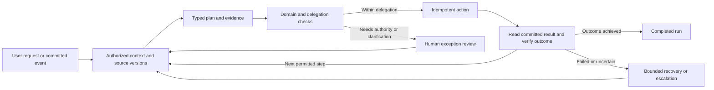

# Kivo design for human and agent work

Design version 1, October 13, 2026. A0 is implemented as a development slice: distinct service principals, delegated registry/credentials, bounded planning reads and inert proposals with human review/API/MCP. Durable runs, inference, autonomous publication and mixed delivery remain planned. See [agent setup](agent-setup.md) and [executed validation](validation.md). This design extends [Product design and iteration plan](product-design.md) and preserves all Float coverage obligations in the [feature register](feature-parity.md).

Kivo is a shared operational system for humans and agents. Both inspect the same authorized plan, propose changes, execute allowed actions and receive evidence of the result. An agent can operate continuously within a delegation instead of requiring a person to approve every step. Humans define outcomes, inspect decisions, resolve exceptions and retain control of the live plan.

## Product model

There are two independent concepts:

| Concept | Meaning | Example |
| --- | --- | --- |
| Acting principal | The authenticated human or agent taking an action | A resource manager or a planning agent moving an assignment |
| Delivery resource | The human, contractor, agent or agent pool assigned project work | A designer producing a concept or an agent producing a draft for review |

An operating agent need not be a schedulable resource. A resource can be scheduled without account access. Neither linking nor assigning work grants authority. Preserve the existing account/person separation as principal/resource types expand.

The initial value loop is **existing workbook → reconciled shared plan → continuously reviewed changes → permitted actions or exception review → published plan and spreadsheet export**. One planner can start without enrolling every employee. Their existing Excel reporting remains available while Kivo becomes the owner of the agreed planning fields.

## Human workspace and machine interface

Humans retain Quiet Canvas: direct schedule manipulation, focused composers, project context and source drill-down. Agent requests can start from the selected project, date range or conflict. A contextual activity/review view shows what the agent is doing and where it needs help. Do not turn the product into a chat transcript or add a permanent wall of agent-status cards.

Agents receive documented typed queries, proposals, action execution, run status and committed event cursors. External agents use the API or MCP; built-in agents use the same application contracts. The UI, API and MCP cannot have different business rules. Authenticated tools advertise only the capabilities the caller may use; hiding a tool is not a substitute for server authorization.

An action result contains status, committed revision, affected references, validation findings, relevant policy decision and available next actions. A rejected action returns a typed reason such as `stale_plan`, `outside_scope`, `approval_required`, `budget_exceeded` or `unresolved_input`. It never reports success merely because a model generated a plausible plan.

## Agent authority and autonomy

Human authentication stays with Auth0. Agents receive a distinct principal with a tenant binding, accountable owner, versioned definition and revocable credential. They never reuse a person's session, a browser cookie or a shared administrator token. Provider API keys used for inference are separate from the agent's authority to change Kivo.

The first machine-auth adapter uses a product-issued per-agent credential, hashed at rest and exchanged for a short-lived agent session. Every use validates current principal/delegation state. Identity contracts permit a later workload-identity adapter; recognizing an issuer does not automatically confer a Kivo membership or grant. Owner/Admin registration and grant changes require the appropriate existing authority.

| Autonomy mode | Allowed behavior | Escalation |
| --- | --- | --- |
| Observe | Inspect scoped data, calculate risks and prepare a digest | Missing or contradictory inputs |
| Propose | Create isolated imports, scenarios or action proposals | Publication needs an authorized reviewer |
| Execute within policy | Commit specified actions satisfying an active delegation and deterministic checks | Scope, precondition, cost, workload or impact limit fails |

Autonomy is set per capability, scope and workflow, not as an unrestricted global switch. The default for new agents is Observe or Propose. A tenant can deliberately grant bounded execution. Fully agentic workflows run without repeated human prompts when the approved policy applies.

A delegation records principal, grantor, purpose, allowed actions, resource scope, permitted data fields, expiry, policy version, tool/model choices, cost/action limits and escalation recipients. Policy limits can include maximum date movement, allowed projects, excluded periods, permitted resource substitutions and no increase in daily overload. Missing thresholds or unavailable financial evidence cause escalation rather than an invented policy result.

The effective authority is the intersection of current principal grants, delegation, run policy and current entity permissions. Child delegation can only narrow actions, scope, expiry and budget; revoking a parent revokes descendants. A principal cannot grant authority it lacks. A budget reservation is shared across concurrent runs so many individually small actions cannot bypass a cumulative limit.

Approval binds to a specific proposal hash, affected versions, policy version and expiry. The reviewer must have authority over every requested effect. Approval cannot grant a new role, allow an unrelated tool call or survive a changed proposal. At commit, recheck identity, delegation, approval/policy, versions and budget in the mutation transaction. Service principals cannot claim the human self-service identity required to submit someone's timesheet or request their leave.

## Durable agent execution

Agent orchestration is a recoverable workflow. The model interprets intent and proposes structured steps. Capability rules calculate capacity, financial impact and eligibility. A constrained tool catalog supplies execution; no arbitrary SQL, shell commands or undeclared network targets enter the planning action surface.

Runs have persisted states: queued, running, waiting for input, waiting for approval, retryable failure, completed, failed or cancelled. Steps separately record proposed, validated, dispatched, committed and verified states. Worker leases use fencing tokens so an expired worker cannot commit after its replacement takes over.

Each run has an outcome, initiator/agent principal, delegation reference, input/source revisions, deadline, maximum steps/model calls, tenant budget reservation, cancellation state and structured rationale. Each step has its typed tool/version, input hash, preconditions, stable idempotency key, authorized decision, result references and verification evidence. Persist structured reasons and outcomes, not private model chain-of-thought. Sensitive context obeys field scopes and retention policy.

Reserve an enforceable upper bound on tool/model usage before dispatch, then reconcile measured usage. Limit output tokens, calls and concurrent work through the adapter contract. A strict monetary cap requires a known bounded pricing contract; uncertain external charges cannot be represented as a guaranteed cap. Record estimate, reservation, measured usage and reconciled charge separately, and escalate when the next step lacks a supported bound.

Reauthorization happens before every effect and when resuming after approval, retry or restart. A previously allowed plan does not retain authority after membership/delegation changes. Retries of the same intent keep the same key; a revised intent gets a new step and key. A timeout after a possible commit resolves its receipt before attempting another mutation.

Each effect commits locally with its audit, receipt, revision and durable follow-up event/job. A run spanning several effects is not one long transaction. Failure after a committed effect produces a visible partial outcome and authorized compensation/recovery; it cannot claim the entire workflow was rolled back. Network/model calls happen outside database locks. External delivery assumes at-least-once attempts and may require reconciliation when provider-side success is uncertain.

Event-triggered runs deduplicate by tenant, rule, source event and policy version. Record causality and suppress a rule's own irrelevant effects so a planning change cannot generate an endless replanning loop. Backoff, maximum depth, deadlines and per-tenant fairness cap load. A paused rule stops new runs; cancelling a run fences pending effects. Completed steps remain historical facts and are reversed only through valid compensating commands.

## Planning rules and tools

Use a versioned, explicitly composed action catalog. Each capability owns the query/command schema, required authority, validation, impact calculation, idempotency behavior and result contract. Protocol adapters translate these contracts; they do not interpret business policy independently. There is no arbitrary runtime plugin dispatch.

| Tool family | Initial operations | Required protection |
| --- | --- | --- |
| Planning reads | Query bounded schedule, calendars, availability and project facts | Tenant/project scope, field redaction, revision and freshness |
| Imports | Inspect upload, suggest mapping, validate staged rows and propose commit | File authority, source references, uncertain values, dry-run boundary |
| Scenarios | Draft future assignment changes, calculate deltas and compare options | Baseline and resource versions; no live-plan side effects |
| Schedule actions | Apply approved/delegated future changes and request valid reversal | Expected versions, impact limits, atomic audit/receipt/event |
| Run control | Inspect, cancel, supply clarification and approve the exact proposal | Run visibility, accountable reviewer, cancellation fence |
| Delivery actions | Dispatch a scoped work item and report evidence | Adapter allowlist, execution quota, output lineage and acceptance policy |

Early external-agent access exposes bounded planning reads, isolated proposals and run inspection. Live schedule actions follow only after the execution/authority gates pass. Finance, membership, billing and human timesheet approval are excluded from initial autonomous execution. Later grants can add narrowly specified actions after their capabilities and policy checks exist.

Imported notes, workbook cells, connector descriptions and retrieved text are source data. They cannot define permissions, override tools or authorize messages. Model output is an untrusted proposed command validated by the server. Retrieval respects current scopes; caches include principal scope/version and tenant. Tenant data reaches a model provider only under an explicit processing policy; manual operations remain usable if inference is unavailable.

## Humans and agents delivering work

Human delivery capacity remains calendar minutes with leave and utilization. Agent delivery capacity uses concurrent execution slots, supported capabilities, queue availability, throughput evidence, cost limits and quality/acceptance requirements. Do not turn a model into an employee with an assumed eight-hour workday or blend agent runtime with billable human hours.

| Resource measure | Human | Agent or agent pool |
| --- | --- | --- |
| Planning unit | Effort minutes on a dated calendar | Work-item reservations, slots and deadline |
| Availability | Effective working calendar and absence | Runner/provider readiness, concurrency and budget |
| Cost | Dated labor rate × approved actual time | Recorded metered usage/provider charge and approved pricing policy |
| Completion | Submitted/approved actuals and deliverable state | Output evidence, checks and accepted result |
| Quality | Required skill and accountable review | Versioned capability, evaluation evidence and acceptance rule |

Hybrid work items have an owner, project, expected output, deadline, dependencies, assigned resource, execution policy and acceptance policy. Separate creator, executor and reviewer identities. An agent may produce a draft that a human accepts, or a deterministic check may accept a defined low-impact result. Required independence rules prevent an executor from approving its own output where the policy demands another reviewer.

Output artifacts remain private files with content hashes, source lineage, producer/run references and review state. Model version, tool version and measured usage accompany agent delivery records. A generated output is not automatically completed project work, an approved timesheet entry or recognized revenue. Human review/rework effort is tracked explicitly; predictions of agent time savings need actual customer evidence.

First support one narrow delivery adapter with a verifiable result, such as producing the weekly staffing review artifact. General autonomous execution across arbitrary customer systems is outside the first launch. Expand adapter workflows through the feature register while preserving every Float product obligation.

## Spreadsheet adoption contract

The first importer supports two declared layouts: tabular allocations (person/project/start/end/effort) and a weekly matrix (people/project rows with dated effort columns). CSV and `.xlsx` are supported inputs. File-size, row-count, worksheet and formula constraints are explicit. Unsupported macros, arbitrary layouts, merged-cell ambiguity or missing working calendars remain reviewable findings; they are not silently normalized.

Keep the original file private and retain worksheet/cell references for mapped values. A model can suggest meanings and units; the mapping reviewer resolves uncertain identities, dates, currencies and formula-derived values before canonical publication. Distinguish cached formula results from recalculated facts. Re-import uses stable source mappings and a previewed difference; it never automatically overwrites a human's newer committed change.

The first useful result is a reconciled two-week plan and explained conflicts, with proposed onboarding time under 15 minutes for supported layouts. That is an experiment target, not an established result. Export the agreed planning data in readable Excel/CSV formats. Preserve customer-specific sheets/unsupported formulas in the retained source, without promising round-trip reconstruction of arbitrary workbooks.

During coexistence, declare which fields Kivo owns and which remain in Excel. Start with snapshot import and explicit refreshed-file reconciliation. Continuous Excel/SharePoint synchronization requires its own connector contract, credentials, field ownership and conflict policy; it is not assumed in the first release.

## Data and module boundaries

| Owner | Planned records and responsibility | Introduction |
| --- | --- | --- |
| Identity and tenancy | Human/service principals, credential/session references, scopes/grants, delegations, revocation and principal-aware audit identity | A0; preserve human role presets and Auth0 |
| `kivo-agents` | Agent definition/version, accountable owner, declared capabilities and execution configuration references | A0 with first registration workflow |
| `kivo-agent-runtime` | Runs, steps, outcome verification, cancellation, budgets and atomic run/action execution ports | A0 proposal lifecycle; durable runtime A1/A2 |
| `kivo-planning` and other capability owners | Typed agent-compatible queries/actions and pure impact validation | A0 planning reads; effects A3 |
| `kivo-scenarios` | Isolated change sets, versioned baselines, comparisons and commit intent | A3 narrow scheduling slice; full economics C8 |
| `kivo-integrations` | Workbook mappings, external IDs, import/reconciliation contracts | A1 narrow spreadsheet slice; full catalog C9–C11 |
| `kivo-jobs` | Durable trigger jobs, leases, retry/dead-letter and delivery fairness | A1 with first asynchronous import |
| `kivo-finance` | Commercial valuation and agent usage cost treatment | C6; measured usage captured in A4 first |
| `kivo-postgres` | Provider implementation of atomic registration, run, import and effect ports | Each slice; never distribute one mutation across committed calls |
| Provider adapters | Model invocation, workbook parsing, approved delivery/connector tools | Replaceable implementations; no provider SDKs in pure contracts |

`apps/worker` is introduced with A1 asynchronous parsing/export jobs. `apps/agent-runner` is introduced with the first built-in durable agent execution, with independent configuration, credentials, queues/concurrency, readiness and shutdown. These executables compose the capability libraries; neither imports another process implementation. API/MCP transport uses the same typed application contracts. Introduce `apps/mcp` only if the transport requires an independent process boundary; an HTTP route alone does not justify another executable.

Avoid a central crate that knows all project, workforce, financial and provider rules. Agent-runtime contracts express typed requests to capability-owned action ports; the composition layer binds only implemented actions. The PostgreSQL adapter owns atomic policy/version/budget/mutation/audit/receipt work, including cross-capability tables. Model calls never hold those locks.

Existing `Actor { user_id }` and user-keyed receipts/audits require an additive principal migration. Backfill human principal references from existing users, retain old IDs/links and compatibility reads, then migrate command/audit writers to principal identity. No current human becomes an agent and no historical audit is rewritten. Register the parent delegation/run/step where relevant. Existing approved time keeps its human owner; resource-kind migration preserves current people as human.

Neon PostgreSQL remains canonical for principals, delegations, runs, policies, jobs and effects. Neon Object Storage holds source/output files. Upstash remains optional acceleration/rate limiting; it cannot own permission, budget, lease or execution correctness. No additional vector database or broker is needed for this launch.

## Early delivery cycles

These cycles precede the full feature-expansion sequence. They extract narrowly scoped parts of C1, C3, C8, C9 and C13; they do not mark those complete. The capability cycles keep their remaining feature obligations. Performance is measured at the initial 10–100-person customer envelope while large-team C1 work remains a later scale gate.

| Cycle | Runnable customer outcome | Depends on | Requirement IDs |
| --- | --- | --- | --- |
| A0 | Humans and external agents inspect scoped planning data and create reviewable proposals | C0 baseline and current planning | AGT01–AGT04, AGT08, AGT12; EXT02/EXT08 narrow tools |
| A1 | A planner brings a supported workbook and receives a reconciled plan/export with agent-assisted mapping | A0 | AGT09–AGT10; EXT01, DIF06 first slice |
| A2 | A built-in planning agent continuously checks the agreed plan and opens evidence-based exceptions | A1 | AGT05–AGT07, AGT11; DIF03 operational explanation |
| A3 | An agent replans future work and commits within an explicit delegation, escalating exceptions | A2 | AGT04, AGT08, AGT11, AGT13; DIF02/DIF04/DIF05 narrow slice |
| A4 | One human/agent delivery workflow produces, reviews and accepts a traceable project artifact | A3 | AGT14–AGT16; advanced project/financial dimensions retain C4/C6 dependencies |

### A0 Human and agent contracts

**Implemented slice:** Owner/Admin registration in Agent activity; version history; project/tool/mode/expiry narrowing (up to four agent levels); hashed credentials and ≤5-minute hashed sessions; bounded non-financial schedule/capacity reads; exact-retry proposals with deterministic previews; human mark-reviewed/reject and agent cancel. The official MCP SDK completes reads/proposals. Human-only APIs still require human identity. Registration/decision commits retain audit/receipts and durable invalidation. No proposal is applied to live work; full run/execution policy remains A2/A3. A0 caps and custom bearer connection limits are in [agent setup](agent-setup.md).

**Slices:** principal migration and registration; delegated planning scopes/credentials; bounded query contracts and source revisions; typed proposals/status plus initial external API/MCP surface. Authentication and policy are mandatory before any machine tool access. External agent connections are explicitly configured by an owner, not created by spreadsheet contents.

**Gate:** legacy human login/roles/receipts/audits remain intact. Independent tenants, projects and finance fields stay isolated. Credential/parent-grant revocation takes effect on requests and pending proposal publication. Agents cannot use human-only self-service or mint permissions. Every proposed action validates its schema, references and current authority. A known external test client completes read/propose/status without UI automation or secret exposure.

### A1 Spreadsheet onboarding

**Slices:** declared layout parser and private source lineage; mapping suggestions/clarification; dry-run reconciliation and versioned import publication; readable export and repeat-file difference. Introduce jobs/worker and the model adapter only with this actual workflow; provider selection/configuration is explicit.

**Gate:** real customer fixtures for both layouts map accurately or visibly request clarification. Hours/identities/dates reconcile and imported fields cannot create grants. Import replay creates no duplicates, failures leave a recoverable staged state, and newer human edits are preserved. Cached formulas, mixed date conventions and missing calendar hours are handled explicitly. Measure first-result time and corrections on customer workbooks.

### A2 Continuous planning agent

**Slices:** agent-runner durable lease/state machine; bounded authorized context gathering; event/schedule triggers and risk checks; exception review/digest and cancellation. Start with capacity/leave/missing staffing; financial analysis requires C6 contracts.

**Gate:** the agent survives restart, accounts for each model/tool attempt and observes cancellation/revocation. Duplicate events produce one logical run; own changes do not create event loops. Step/cost/deadline limits and tenant fairness hold under concurrent runs. Claims point to source days/assignments and cannot invent availability. Prompt instructions in workbook data cannot change tool authority. Inference failure leaves normal human planning available.

### A3 Delegated action and verification

**Slices:** narrow future-schedule scenario contract; policy-aware impact preview; exact-proposal approval or preauthorized commit; post-commit verification/receipt recovery; conflict-safe compensation. A rule can authorize a known class of changes without asking a human on each execution.

**Gate:** test an automatic in-policy replan, a larger change needing review, a stale approval, a revoked delegation, two concurrent agents competing for a budget and a timeout after commit. An expired worker's fencing token cannot authorize a mutation. No retry doubles a change or spends a limit twice. An intervening human edit causes re-evaluation. Completed work/approved actuals remain untouched. Show partial multi-step progress and safe recovery honestly.

### A4 Hybrid delivery

**Slices:** resource-kind and slot reservation contracts; scoped work-item adapter; evidence/output artifact; human or explicit deterministic acceptance; measured usage and review/rework record. Select one adapter whose output can be verified in the pilot, starting with a staffing review artifact.

**Gate:** concurrent claims do not exceed agent slot/budget limits; queued, failed, generated and accepted work are distinct. A rejected output produces rework/failed state, not completed delivery. Human hours and agent execution usage report separately, with producer/reviewer lineage and no fabricated savings or margin. Provider/model changes invalidate unsupported capability assumptions. More general project dependencies and financial valuation wait for their designated C4/C6 rules.

## Pilot and expansion gates

A1/A2 support an observation pilot with explicit processing consent and a recorded supported workbook/customer envelope. Live delegated changes require A3 correctness, human rollback/recovery, tenant-safe logging, restore rehearsal and support contact/runbook. These operational gates apply before externally relied-on autonomous writes; do not postpone them to the later C12 enterprise/billing cycle.

The first paid pilot requires A3, the pilot's required planning functionality, measured operating costs/limits and basic commercial/privacy terms. C12 adds automated subscription management and broader enterprise/service controls. Full Float parity still requires all documented feature/register checks and native mobile/confirmed connector coverage. A4 hybrid delivery can follow a successful A3 pilot and is not a reason to delay first planning value.

Validate with five spreadsheet-based planners: first reconciled plan within the supported-layout target, at least 30% reduction in matched weekly planning effort, repeated use for four weeks and a recorded decision to pay. Separately evaluate unauthorized action rate (zero accepted in the adversarial suite), correct conflict detection, inappropriate escalation, successful completion, cost per useful outcome and recovery from partial effects. Record thresholds, datasets and actual results; no run count or chat volume substitutes for value.

## Scope and remaining choices

The first agentic product handles workbook intake, capacity monitoring and future-work replanning. Advanced finance, rich leave policies, every connector and native mobile remain covered in C cycles. Teams can continue manual planning and exports throughout adoption. The long-term product supports mixed human/agent delivery, with staged adapters rather than arbitrary execution access.

Model/vendor selection, supported external agent clients, the first delivery adapter and exact policy thresholds are assigned implementation decisions in A0–A4. Benchmark provider quality/cost on the defined fixtures before selection; do not invent a free inference entitlement. Local/test adapters can validate orchestration contracts while a hosted model is configured. Kivo's three selected data services stay unchanged.
