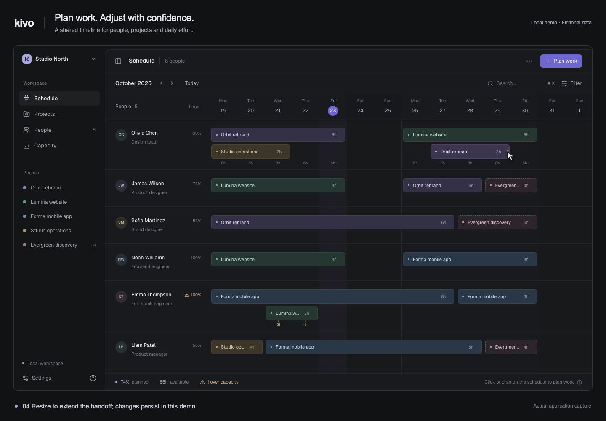
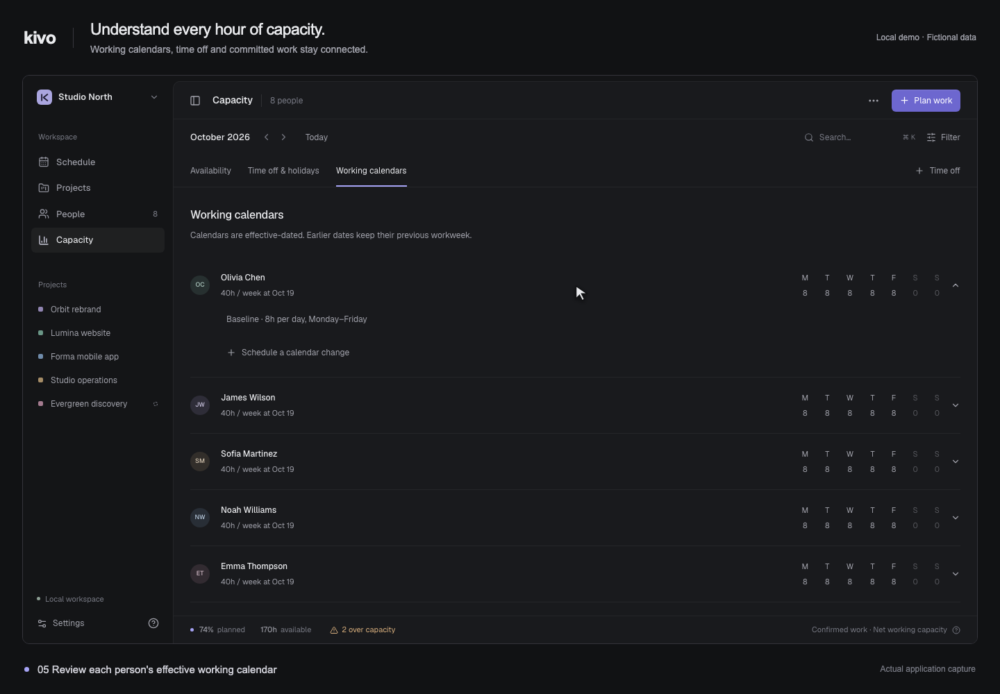
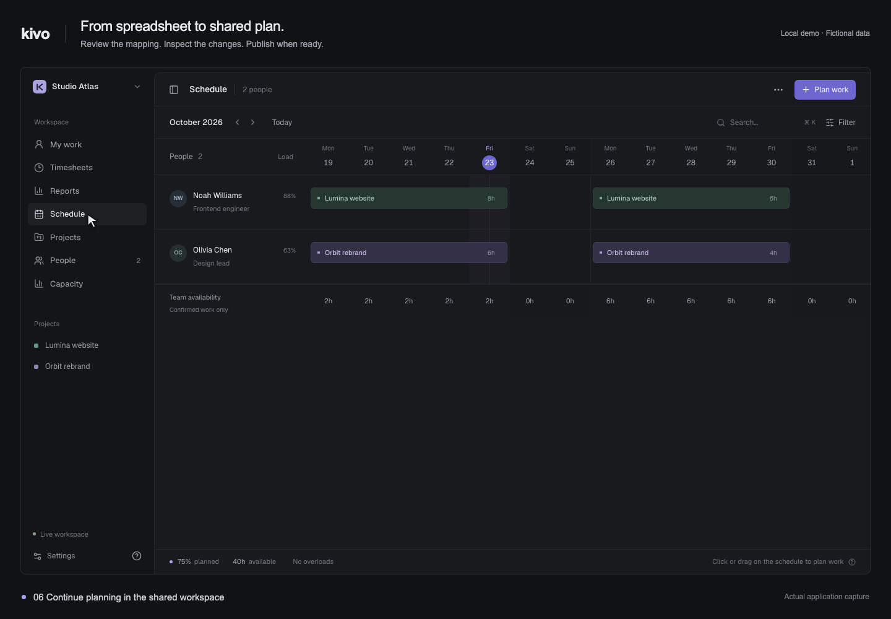
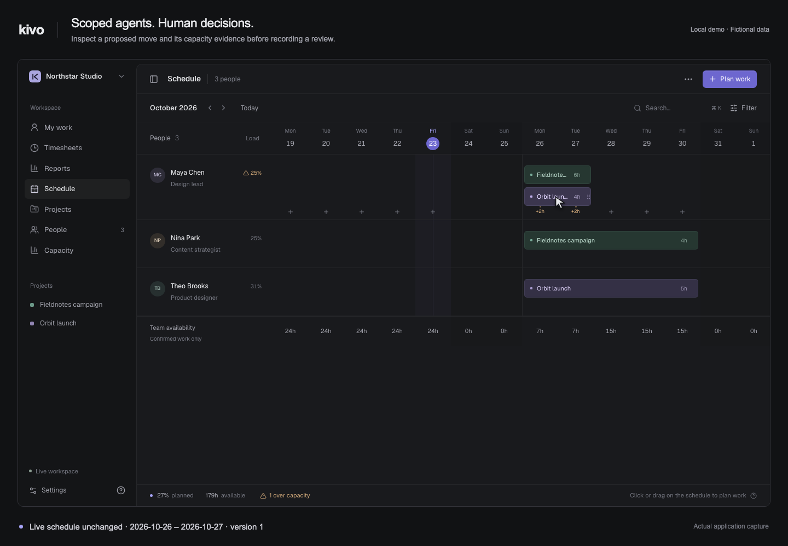

# Kivo feature demos

Recorded October 23, 2026 from the running Kivo application with fictional data. The caption frame and visible cursor are supplied by the recorder; the product interfaces and interactions are real.

| Feature             | What the recording shows                                                                                                                                 | Video                           | Still image                   |
| ------------------- | -------------------------------------------------------------------------------------------------------------------------------------------------------- | ------------------------------- | ----------------------------- |
| Scheduling          | Create a two-day allocation, drag it earlier and extend its end date; persisted dates are checked.                                                       | [WebM](scheduling.webm)         | [PNG](scheduling.png)         |
| Capacity            | Inspect an overload, add four hours of leave, inspect the resulting capacity and open working calendars.                                                 | [WebM](capacity.webm)           | [PNG](capacity.png)           |
| Spreadsheet imports | Upload a CSV, manually map columns, confirm identities/calendars, preview four additions and 120 planned hours, publish and inspect the shared schedule. | [WebM](spreadsheet-import.webm) | [PNG](spreadsheet-import.png) |
| Agent review        | Inspect a scoped move proposal, compare capacity evidence, mark it reviewed and return to the unchanged live schedule.                                   | [WebM](agent-review.webm)       | [PNG](agent-review.png)       |

The README embeds 1080 × 750 GIF previews that play twice. Videos and still images are 1440 × 1000; videos have no audio. The captures demonstrate local development workflows. They do not establish hosted operation, customer workbook quality, model accuracy or performance at scale. [Executed validation](../validation.md#readme-and-feature-recordings--october-23-2026) records the checks.

## Reproduce the captures

Run from the repository root. Capture tools are optional authoring dependencies: Node.js, Playwright with Chromium, Python with Pillow, and FFmpeg with the VP8 `libvpx` encoder. They do not change Kivo's application dependencies. Set `KIVO_PLAYWRIGHT_MODULE` to an absolute Playwright module path if it is outside this repository, `KIVO_CAPTURE_CHROMIUM` for a particular browser executable, and `KIVO_CAPTURE_FFMPEG` if FFmpeg is outside `PATH`.

Use a separate generated copy of `apps/web` under ignored `output/`, without `.env` files, for the browser demo. Start it on `127.0.0.1:3004` with `NEXT_PUBLIC_STORAGE_MODE=local`. Use the existing disposable backend harness for the shared workflows:

```sh
KIVO_IMPORT_BROWSER_QA=1 npm run test:imports
```

It creates isolated PostgreSQL, API, worker, realtime and storage/model fixtures, serves the shared frontend on `127.0.0.1:3002`, and writes `output/import-browser-fixture.json`. Wait for the frontend to be available before recording. For these captures, only the generated QA frontend's `next.config.ts` set `experimental.agentUpgrade: false` to prevent an interactive framework reminder from stopping startup; the application's configuration was unchanged. The demo frontend also used an environment without hosted credentials. Never point capture scripts at a real workspace.

In a second terminal:

```sh
node scripts/readme-capture-planning.mjs
node scripts/readme-capture-imports.mjs
node scripts/readme-capture-agents.mjs
python3 scripts/readme-encode.py scheduling capacity spreadsheet-import agent-review
```

The scripts use disposable browser contexts, loopback origins and actual UI operations. Shared capture scripts check the current fixture marker before creating data. Scheduling/capacity/import fixtures use the October 23, 2026 browser date; the agent scenario derives future work dates from the current server date. Start a fresh harness before repeating a completed import capture. Agent credentials are created before recording and retained only in process memory.

Raw frames, step manifests and contact sheets remain under ignored `output/readme-capture/`. Only the compressed GIFs, WebM videos and PNG stills are kept here. The encoder verifies frame counts, dimensions and recorded application errors; GIF timing preserves the eight-frame-per-second source. Stop owned fixture processes with Ctrl+C after capture to remove their temporary database and files.

## Still images

### Scheduling



### Capacity



### Spreadsheet imports



### Agent review


