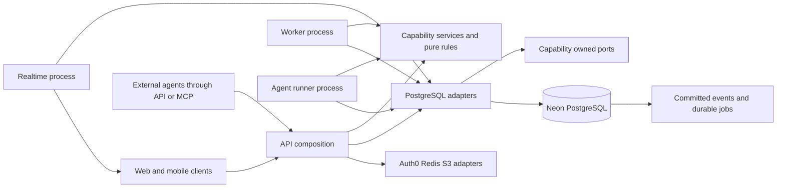

# Kivo product design and iteration plan

Design version 3, October 13, 2026. Baseline commit: `1827dec`; current A0 implementation/evidence is recorded below and in [validation](validation.md). This plan covers Float's documented feature set and Kivo's shared workflows for humans and agents. It defines early adoption, capability expansion, ownership boundaries and release gates. Future cycles are designed scope, not completed functionality or delivery-date commitments.

Kivo should let humans and agents scope work, staff it, adjust the plan, capture delivery and understand the financial result in one coherent operational system. Agents can run continuously and execute within an explicit delegation, with people resolving exceptions and retaining control. Functional Float parity remains the coverage requirement. The competitive objective is less work to maintain a trustworthy plan.

Read [Human and agent system design](agentic-system-design.md) for principal identities, delegated autonomy, durable runs, mixed delivery resources and early A0–A4 cycles. [Feature coverage and Float parity](feature-parity.md) is the requirement register; [Quiet Canvas](design-system.md) defines visual/interaction rules; [Architecture](architecture.md) records implemented contracts; [Validation](validation.md) records executed evidence. Feature IDs connect changes to this plan. The C0–C14 capability roadmap remains intact, with early slices deliberately brought forward for adoption.

## Product scope and success criteria

The initial customer hypothesis is a professional services team of 10–100 scheduled people maintaining its weekly plan in Excel across concurrent client projects. One planner can start with a supported workbook, receive a reconciled shared plan and delegate monitoring/replanning without requiring a company-wide rollout. Agencies, consultancies and internal delivery teams are candidate segments to validate. Architecture and scheduling benchmarks also cover 1,000 people and 20,000 assignments; that larger envelope is a scale gate, not a prerequisite for the first customer trial.

The required product includes scheduling, capacity and leave policies, people and staffing profiles, project scoping and estimates, time tracking, project economics, reports, collaboration, scoped access, integrations, administration and mobile access. Each capability exposes appropriate typed human/agent workflows. Operating agents and agents assigned delivery work are distinct: account authority is separate from resource capacity. Float's beta and exploratory features retain those classifications in the register. Equivalence means completing the same business job; Kivo may use a different interaction or explicit calculation policy.

Kivo's additional requirements are fast interaction at scale, previews of consequential changes, explainable metrics, isolated scenarios, safe bulk apply/undo, migration reconciliation and understandable pricing. They are hypotheses to validate against customers' existing process. Float already describes scenarios and AI-assisted staffing, so their mere presence is not evidence of superiority. [Float project planning](https://www.float.com/product/project-planning), [Float AI capabilities](https://www.float.com/ai).

| Outcome | Proposed acceptance criterion | Evidence needed |
| --- | --- | --- |
| Feature coverage | Every documented requirement and confirmed connector route passes its equivalent workflow | Register linked to API/browser checks; unresolved differences remain visible |
| Usability | Four of five target users complete setup, staffing, a delay adjustment and conflict diagnosis without help | Observed sessions using realistic projects |
| Workflow advantage | Median completion time at least 30% lower than the same users' existing planning process | Paired task definitions, comparable datasets, errors and learning effects reported |
| Product performance | p95 input-to-paint below 100 ms on the defined large-schedule fixture | Browser traces on a recorded device/network profile; cold start reported separately |
| Correctness | Capacity, approved time, costs and forecast values reconcile with independent examples | Contract tests and source drill-down in the application |
| Commercial value | Three teams migrate real plans, use Kivo for four consecutive weeks and agree to pay | Weekly planning activity, interview feedback and actual purchase intent |
| Agent autonomy | Complete delegated planning outcomes and escalate out-of-policy changes; no unauthorized accepted action in the adversarial suite | Source-grounded results, policy decisions, recovery evidence and cost per useful outcome |
| Spreadsheet onboarding | First reconciled plan within 15 minutes for supported tabular/weekly layouts | Customer workbooks, corrections and import reconciliation; target, not measured result |

No superiority, production-scale or financial-accuracy claim follows from a build passing. [Validation](validation.md) remains the record of what was actually exercised.

## Current baseline

Public acquisition entry (DIF07 slice): `/` presents current scheduling, capacity, time and scoped-agent proposal workflows with an illustrative interactive preview, clear early-access status, FAQ and signup/login. `/app` retains the existing workspace and onboarding. Owned by `features/marketing` plus the identity route bridge; no schema or backend command changes. Public examples use pure scheduling rules, never tenant data. Acceptance covers responsive/keyboard interaction, accurate dates/numbers, authenticated and anonymous routes, OAuth return paths and invitation continuity. Pricing and paid-pilot evidence remain C12 work.

The C0/DIF07 presentation refinement adds a pausable product tour, three-scene planning workflow, team/person capacity perspectives and shared-plan illustration. `features/marketing` owns composition, individual examples, scoped styles and playback/reveal lifecycles. Schema, APIs and transaction boundaries are unchanged: these examples use isolated fixture data and pure calculations. Acceptance additionally covers autoplay/pause, manual control, offscreen suspension, reduced motion, focus restoration and stable scene dimensions at desktop/mobile sizes.

Inline SVG illustrations own allocation movement, capacity-bar geometry and shared-plan paths in the marketing module. They use native CSS motion with accessible image descriptions and pausable continuous playback. Acceptance includes actual SVG transform/path movement, frozen animation while paused/offscreen, accurate capacity labels, stable responsive dimensions and a complete reduced-motion composition. No new integration or tenant transaction is introduced.

| Area | Implemented development baseline | Remaining scope |
| --- | --- | --- |
| Identity and organizations | Auth0 sessions, verified signup/invitations, personal/team setup, membership roles, explicit account-to-person enrollment; distinct delegated service principals | Scoped human visibility, automated invitation delivery, enterprise policies, billing |
| Scheduling | Create/edit/move/resize, dates and daily minutes, confirmed/tentative work, daily overloads, basic filters, keyboard operations | Effort formats, selection/bulk commands, recurrence, saved views, dependencies, shared undo |
| Capacity | Effective weekly calendars, full/partial-day absences, manual holidays, conflict sources | Employment dates, policy balances, regional feeds, clock intervals, overtime exceptions, structured staffing data |
| Projects | Client label, status, hour budget, current bill rate, planned hours and assigned people | Client entities, phases/tasks/milestones, templates, demands, baselines, budget models and expenses |
| Self-service | My work, own time entries, weekly submission/approval locks, own leave request and administrative review | Suggestions, timer, deadlines, auto-log, delegated reviews and controlled corrections |
| Reporting | Date-filtered planned/recorded/approved hours, utilization, person/project totals, lifetime approved hour-budget use and CSV | Financial calculations, other dimensions, operations/finance overviews, baseline comparison and alerts |
| Persistence and collaboration | Neon PostgreSQL, transactional authorization/version/audit/receipts, committed events and separate realtime process; bounded A0 tool reads | Bounded workspace bootstrap, incremental refresh, throughput evidence, restore/recovery operations |
| Files and providers | Private Neon Object Storage through S3 API; optional Upstash request limiting | Product import/export flows, durable jobs, retention/cleanup and integrations |
| Agents and mixed delivery | A0 versioned registry, revocable narrowed delegations, short sessions, financial-free reads, inert move proposals and human review via UI/API/MCP | Workbook intake, durable runs, inference, delegated live effects, agent resources and outcome acceptance |

The browser-local demo is a separate, labelled planning adapter. Shared self-service currently requires the API. New business capabilities target shared workspaces first; the demo must preserve its existing functionality. A new feature appears in demo mode only after its local contract is deliberately implemented and tested.

The current backend has three executable crates and fifteen library crates. Organization writes serialize through an organization advisory lock; clients generally refresh a full workspace after committed changes. A0 tools have separate bounded range/page contracts. These provide a reliable development foundation but are not proof of high throughput. Hours reports contain no project profitability calculation. Human roles can read organization planning data; service principals require explicit project/tool scopes. Self-service does not yet imply restricted team visibility.

## Product surfaces and interaction design

Quiet Canvas remains the single theme. Keep one work canvas, one location header and one contextual toolbar. Add capabilities through views, contextual details and focused composers. Agent activity and exception review stay in context with the affected plan; run detail is inspectable on demand. A new capability does not automatically receive a permanent navigation item or a dashboard-card grid. Human control is never confined to a chat interface.

| Surface | User's primary job | Planned evolution |
| --- | --- | --- |
| My work | Understand personal assignments, availability and required action | Personal schedule, leave balances, timer, time suggestions, review items and agent handoffs; default for members |
| Schedule | Allocate and adjust committed or tentative work | People/project grouping, filters, selection, recurrence, effort formats and contextual change previews |
| Capacity | Find pressure, usable availability and unfilled demand | Team/role views, hiring demand and source explanations; retain existing capacity navigation |
| Projects | Scope, staff and monitor delivery | Project list plus focused timeline; phases, tasks, milestones, baseline and budget context |
| People | Maintain delivery resources and staffing evidence | Human directory/calendars plus agent/resource views with distinct slot, capability and budget measures |
| Timesheets | Confirm actual work and submit a period | Suggestions, timer and period correction; team review is a role-aware mode |
| Reports | Investigate capacity, delivery and financial drift | Shared date/filter grammar, operations/finance views, comparison and inspectable calculations |
| Settings | Govern access, agent delegation, working policies, billing and connections | Agent registration/policies and dedicated administration sections; keep controls out of planning chrome |

The shell owns navigation, active organization and shared context. Feature modules own view state, commands and composers. Project/person inspection may occupy a temporary detail surface; entity creation/editing retains the established focus-managed composer. Comparison uses the work canvas with a visible baseline and differences. Do not introduce a second interaction grammar for finance, scenarios or AI.

### Required journeys

1. **Set up or join.** A new owner chooses personal/team setup, establishes calendars and adds or imports resources. An invited user joins the existing workspace with the granted scope. Enrollment and access remain separate; joining never duplicates a team or implicitly grants scheduling rights.
2. **Scope and staff.** Create a project, choose its commercial model, define phases and role demand, inspect availability and costs, assign people, then save a baseline. Unfilled roles stay visible as demand; they do not consume a named person's capacity.
3. **Respond to a change.** A human or agent selects future work after a delay, calculates impact and compares alternatives. A human commits the preview, or an agent commits under an active delegation whose limits pass. Exceptions request qualified review; historical actuals remain attached to their original dates.
4. **Record delivery.** Review planned suggestions, confirm or edit actuals, submit the week and receive a review result. Approved facts lock. A correction is a separate, reasoned workflow with a preserved audit trail.
5. **Review results.** See operational or financial drift, inspect the calendar/entry/rate behind a value, and open the relevant plan from that explanation. Draft time and missing rates cannot masquerade as finalized financial performance.
6. **Manage leave and access.** Request leave, show the assigned reviewer and projected effect, approve under the policy, and update capacity once. Scope changes revoke future access, including sockets, exports and connectors, without erasing delivery history.
7. **Delegate a planning outcome.** Register an agent, define allowed actions/projects, limits, expiry and escalation, then validate the policy on representative changes. The agent observes, plans, acts and verifies continuously within that authority. A human can inspect, pause, cancel or correct the result.
8. **Deliver mixed work.** Assign a scoped work item to a human or agent resource, inspect its output evidence and accept it under the declared review rule. Human calendar effort and agent execution usage retain different units and cost treatment.

Every journey includes loading, empty, validation, permission, stale-version, network failure and recovery behavior. Keyboard alternatives, touch controls, focus restoration and reduced motion are acceptance requirements. A working gesture must never wait for decorative animation.

## Domain contracts and calculation policies

### Scheduling and capacity

Dates remain date-only business values in the workspace timezone. Existing daily-hour assignments preserve their effort when leave is added. Effective calendars define base capacity; approved leave and holidays reduce net capacity. Capacity warnings permit intentional overload with visible consequences. Pending leave remains separate from approved capacity reductions.

C2 introduces a typed effort representation rather than overloading `dailyMinutes`: daily minutes, percentage in integer basis points, fixed total minutes over a date range, or clock intervals. Current assignments migrate as daily-minute effort. Percentage effort uses each day's base work calendar, not the hours remaining after other assignments. Leave creates a visible conflict rather than silently shrinking a commitment. Fixed-total effort uses explicit distribution over eligible workdays; calendar changes produce a preview before redistributing fixed work. Rounding and remainder distribution use identical reference fixtures in Rust and TypeScript.

C3 introduces deliberate overtime exceptions on otherwise non-working dates and interval absences. A holiday never silently restores capacity just because work is scheduled. Legacy whole/partial-day absences keep their current maximum-overlap rule; new intervals use the union of occupied time. A migration/version marker distinguishes the two representations. Reject ambiguous mixtures until an explicit normalization rule applies. DST gaps/overlaps in clock work require a visible timezone and documented resolution; ordinary date planning remains unaffected.

Recurrence stores a rule, a stable series identity and occurrence exceptions. Expand only a bounded query horizon, preserve occurrence identity across edits, and support this occurrence versus this-and-future changes. Do not create infinite rows or regenerate completed work. Dependency links form an acyclic graph within a project. Propagation uses a previewed command; a cycle, unauthorized descendant or changed version rejects the whole command.

Project/phase states and assignment states become typed. Parent transitions have explicit propagation rules; completed/cancelled work cannot become confirmed through a drag. An assignment's planned billability comes from its task/phase/project policy; actual entries preserve their recorded attribution and approved commercial facts.

### Project economics

Financial ownership is separate from reporting. Money uses currency-tagged minor units with a currency exponent; rates and FX use fixed decimal/rational representations. Never use binary floating point for accounting values. Rate precedence is task/phase/project override, client-role card, person/role default, then an explicit missing-rate state. Each resolved value records its source and effective date. The precise precedence becomes a C6 contract fixture before UI work.

Approved time captures cost rate, applicable bill rate, currency, FX basis and commercial policy in immutable financial facts. Current rates cannot rewrite those facts. Forecasts use dated rates and retain their assumptions and calculation revision. Existing approved time without historical evidence is marked unresolved until an administrator supplies an auditable valuation; no historical rate is invented from today's value.

| Metric | Calculation policy |
| --- | --- |
| Net capacity | Effective base calendar minus the defined union/legacy reduction of approved absence and holiday |
| Planned utilization | Confirmed planned minutes divided by net capacity; zero denominator is undefined |
| Actual utilization | Recorded or approved minutes divided by net capacity, with the selected basis named explicitly |
| Actual labor cost | Sum of approved minutes × captured cost rate, with specified rounding |
| Agent delivery cost | Verified metered usage/provider costs under the selected valuation policy; never derived from human-hour utilization |
| Total delivery cost | Human labor + agent delivery + non-labor expenses, with disjoint attribution to prevent double counting |
| T&M billable value | Approved billable effort × captured bill rate, plus applicable billable expense value |
| Forecast completion cost | Approved cost to cutoff + remaining planned cost after cutoff + forecast expenses; unfilled demand valued and labelled separately |
| Fixed-fee forecast margin | Contract fee minus forecast completion cost, divided by contract fee; zero fee is undefined |
| Hour-budget use | Approved lifetime hours divided by the selected version of the hour budget |
| Retainer use | Hours/value consumed against a dated period allowance with explicit rollover and overage rules |

Recorded drafts remain useful for operations but cannot silently enter approved financial actuals. Past scheduled work without actuals is reported as unreported work, not silently assumed completed or removed from the forecast. A forecast cutoff and remaining-work policy prevent planned and actual hours from being counted twice. Fixed-fee reporting describes expected delivery margin; accounting revenue recognition and invoice/tax accounting are separate integrations, not an inferred result from a schedule.

Financial and capacity baselines pin their source versions. Closing a reporting period captures its capacity denominator and approved financial facts. A historical correction produces a new adjustment/revision and preserves the previous result for audit. Open-period capacity reports remain restatable and show the applicable revision.

### Access and historical identity

Existing Owner/Admin/Planner/Member/Viewer roles remain valid presets. C3 adds capability grants and scopes for organization, department, project or self. A grant contains an action and a scope; finance, approval, billing and security are distinct actions. Visibility and mutation checks run on the server and in the database transaction where state can change. The UI uses resolved permissions, not assumptions about role names.

Self-service continues to derive its person from the verified membership association. Delegation never lets a member select someone else's time identity. Removing membership revokes access and leaves historical person/time facts intact. Archiving a resource stops new assignment and has an explicit account-access choice; last-owner protection applies. Reactivation does not silently restore old grants. Export jobs and assistant calls use the same scopes and reauthorize when delivered.

Working-week and display-format preferences are separate. Changing the start of a workweek takes effect for future time periods and does not rekey an existing submitted/approved sheet. Ownership, period boundaries and the applicable policy version stay attached to historical records.

## Data model and capability ownership

Existing public contracts are preserved during extraction. Additive migrations belong to one globally ordered stream owned by the migrator. Existing applied migrations and checksums are immutable. A capability owns its rules and schema meaning; `kivo-postgres` owns SQL adapters and transaction mechanics. Independent growth does not require separate databases.

| Capability | Data and public contract | Ownership plan |
| --- | --- | --- |
| Tenancy and identity | Organizations, human/service principals, grants/scopes, delegations, verified identities and access policy | Existing `kivo-tenancy`, `kivo-identity`, `kivo-auth0`; agent contracts A0, richer human scopes C3 |
| Agent registry | Versioned definitions, accountable owners, declared tools and configuration references | New `kivo-agents` in A0; authority stays with identity/tenancy |
| Agent runtime | Runs/steps, bounded execution, cancellation, budgets, verification and typed action ports | New `kivo-agent-runtime` in A0; built-in durable execution A1/A2 |
| Workforce | People, employment, departments/roles/skills, calendars, statuses, absence facts and policy references | Extract cohesive `kivo-workforce` from planning in C3 with the first expanded workflow |
| Scheduling | Assignments, effort distributions, recurrence/exceptions, links, saved views and planning commands | Existing `kivo-planning`; keep scheduling/capacity evaluation modules cohesive |
| Project planning | Clients, projects, project teams, phases/tasks/milestones, demands, templates and hour baselines | Extract `kivo-projects` in C4; scheduling consumes its narrow eligibility/value contracts |
| Time tracking | Entries, sheets, timer sessions, submission settings and correction records | Existing `kivo-time-tracking`; extend in C5 |
| Leave requests | Request/review states, delegation, policy consumption and generated absence | Existing `kivo-leave-requests`; workforce contract replaces planning-owned absence types in C3 |
| Finance | Currencies, FX snapshots, rates/cards, budget versions, expenses and approved financial facts | New `kivo-finance` in C6; depends on tenancy and typed value references, not reporting |
| Reporting | Metric definitions, query results, revisioned projections and comparison views | Existing `kivo-reporting`; consumes capability value contracts and snapshot ports |
| Scenarios | Baseline references, draft change sets, assumptions, comparisons and commit receipts | New `kivo-scenarios` in A3 for scheduling; full financial comparison C8 |
| Integrations | Connections, secret references, external IDs, field ownership, cursors and reconciliation | New `kivo-integrations` in A1 for workbook intake; full expansion C9–C11 |
| Jobs and notifications | Durable job lifecycle, leases, delivery attempts and preferences | New `kivo-jobs` with A1 async intake; notification capability with first real delivery workflow |
| Billing | Seat ledger, subscription mapping, webhook receipts and entitlements | New `kivo-billing` plus Stripe adapter in C12 |
| Assistance | Structured interpretation, evidence references, proposed actions and evaluations | Narrow model ports in A1/A2; extract a cohesive expertise/query capability with a C13 consumer |
| Files and realtime | Private files, upload verification, subscription tickets and committed event delivery | Existing capability/provider crates; extend for exports, cleanup and scoped refresh |

The new libraries listed here are plans, not scaffold to create now. Each cycle introduces only the boundary required by its first consumer. Finance must not depend on reporting; project/workforce contracts must not depend on scheduling commands; capability libraries must not depend on provider crates or executable crates. Repositories expose complete atomic use cases, not public SQL transactions or loosely coordinated CRUD calls.

Arrows denote dependency/use, not synchronous calls between every box. Events, jobs, authority and run state live in PostgreSQL. Clients never receive provider credentials. `apps/api`, `apps/migrator` and `apps/realtime` keep independent lifecycles. A1 introduces `apps/worker` with asynchronous imports; built-in durable agent execution introduces `apps/agent-runner`. Each has its own configuration, health, shutdown, concurrency limits and tests. Further processes require a real deployment/credential/scaling boundary.

## Persistence and throughput design

Use Neon PostgreSQL as canonical storage, Upstash for optional rate limiting/rebuildable acceleration, and Neon Object Storage for private imports, exports and attachments. Analytics stays in PostgreSQL. No new database, broker or search service is required for these cycles. Free-tier quotas are experimental operating limits; the cost/load review in C12 decides a supported production envelope without changing correctness contracts.

### Read paths

A0 now exposes principal-aware planning reads for 1–93 inclusive days and up to 200 assignments per UUID page, with associated scoped people/project metadata; capacity takes one person at a time. C1 completes workspace bootstrap/directory separation and large-team performance. Its richer schedule request will select an organization, date window, grouping, filters and row cursor. Planned defaults are 100 people and 14 days; caps are 200 people and 93 days, plus a bounded assignment page. Exact caps are configurable only within tested budgets. Never return unlimited history because a filter is empty.

Each response identifies its committed organization revision and calculation version. Pagination uses stable sort keys and tenant-bound opaque cursors. Pages may observe later revisions; the client must reconcile affected loaded rows, not claim a cross-request snapshot. Reports that require a consistent aggregate use one bounded database snapshot or a persisted projection tied to a revision. Do not hold a database transaction open across browser requests.

Index reads by tenant, person/project and overlapping dates; compare B-tree and range/GiST plans on the actual fixture. Build per-person date buckets for browser evaluation and update only affected intervals. Realtime invalidations identify entity kinds and affected ranges without exposing forbidden data. A reconnect beyond event retention triggers a bounded fresh snapshot. Any cache key includes tenant, permission/scope version, query and revision; Redis loss can only reduce performance.

### Write paths and locks

Preserve authorization, expected-version checks, business validation, mutation, audit, idempotency receipt, revision/event and any required job in one PostgreSQL transaction. The current organization lock stays until contention measurements justify a replacement. Never substitute a Redis lock for scheduling correctness.

C1 benchmarks both distributed tenants and a busy single tenant. If serialization is the limiting factor, produce a lock-order design before changing it: stable authorization checks, deterministically ordered resource locks, aggregate/recurrence/dependency conflict checks, and a short revision-sequencing section that preserves commit order. Apply that protocol to every writer, including membership changes and workers. Scope revocation, last-owner protection, duplicate retries and deadlock recovery must pass under contention. A faster partial protocol is not an acceptable intermediate state.

Bulk apply and undo are normal authorized commands with expected versions. Agent effects additionally check active delegation, proposal/policy references, cancellation fence and budget in that same transaction. Store before/after references and inverse intent. Undo succeeds only when its preconditions still hold; intervening edits produce a previewable conflict. It never rolls back another planner's work. Large project shifts show their complete affected set before a bounded atomic commit; operations beyond the tested transaction cap require a separately designed publication protocol, not silent partial commits.

### Durable work and projections

PostgreSQL jobs use claim leases, bounded retry/backoff and dead-letter state. Workers may claim with `FOR UPDATE SKIP LOCKED`; completion records its durable result and idempotency receipt. A crashed lease can be reclaimed. Job priority/fairness prevents one tenant monopolizing the worker. External delivery assumes at-least-once attempts; use provider idempotency where available and expose delivery status rather than claiming exactly-once email or webhook delivery.

Imports first store a private source file, validate a dry run and persist mappings/errors. Commit occurs only after preview. Exports pin filters, scope and data revision, write a private object, then publish authorized metadata. Cancellation is safe before publication; a committed import is reversed only through version-checked commands that preserve subsequent work. Both use expiring links, size limits and cleanup jobs.

Reporting projections are disposable derived data with a calculation/schema version and last applied source revision. Out-of-order or duplicate events cannot double count. Stale projections show freshness and can be rebuilt/reconciled from authoritative facts. No projection owns approval state or financial truth.

## Iteration sequence

Run C0 baseline/fixture sizing first, then the [early A0–A4 delivery cycles](agentic-system-design.md#early-delivery-cycles): shared principal/action contracts, workbook onboarding, continuous observation, delegated replanning and one mixed-delivery workflow. An A3 planning pilot can precede A4 and the full capability expansion. These cycles pull forward narrow C1/C3/C8/C9/C13 slices; they do not complete those entire capabilities.

The table below is the retained capability-expansion sequence. A cycle ends when its gates pass, not when its screens exist. Effort estimates and dates follow sizing; none are implied. Features already delivered by an A cycle retain their evidence and are extended, not rebuilt, in their C cycle.

| Cycle | Usable outcome | Depends on | Main requirements |
| --- | --- | --- | --- |
| C0 | Verified baseline and executable acceptance fixtures | Current implementation | All register entries classified; current regressions |
| C1 | Fast bounded scheduling with measured service limits | C0 | DIF01, OPS02; SCH01 regression |
| C2 | Professional everyday schedule editing | C1 | SCH02–SCH09, SCH11 notes, DIF02 |
| C3 | Governed workforce, leave and scoped team access | C2 | PEO01–PEO09, SCH12, GOV02–GOV04 |
| C4 | Complete project scoping and staffing workflow | C2, C3 | PRJ01–PRJ10, SCH10; project scope |
| C5 | Reliable actuals and durable reminders | C3, C4; jobs from A1 | TIM01–TIM06, EXT04 email |
| C6 | Correct project economics with immutable history | C4, C5 | FIN01–FIN08 |
| C7 | Operational and financial reporting with explanations | C1, C3–C6 | REP01–REP06, GOV05, DIF03 |
| C8 | Extend early replanning to full project/financial alternatives | A3, C2, C4, C6, C7 | DIF04–DIF05; AI01 richer options |
| C9 | Extend workbook onboarding to full migration/public API | A1, C1, C4–C7 | EXT01–EXT02, DIF06 |
| C10 | Calendar and communication workflows | C3, C5, C9 | EXT03–EXT04, SCH11 mentions, MOB01 |
| C11 | Verified PM, automation and partner catalog coverage | C9, C10 | EXT05–EXT07 |
| C12 | Supported paid service with billing and enterprise controls | C6, C7, C9, C10; pilot-selected C11 routes | GOV06, GOV08–GOV09, DIF07, OPS01–OPS05 |
| C13 | Extend agent operations to expertise and richer cross-system outcomes | A0–A3, C4, C6–C9, C12 privacy controls | AI01–AI04, PEO10, EXT08 expansion |
| C14 | Native mobile parity and appearance preferences | C5, C10, C12 | MOB02–MOB03, GOV07 appearance |

The early pilot gates in [Human and agent system design](agentic-system-design.md#pilot-and-expansion-gates) cover live agent effects, restore/recovery, privacy, support and commercial terms before customers rely on autonomous writes. C12 adds automated billing and broader enterprise/service controls. Full Float parity requires the complete documented register, confirmed integration routes and native mobile workflows. Security, accessibility and observability start in A0 and continue through every cycle.

### C0 Baseline and acceptance design

**Deliver:** a current feature walkthrough, representative planning workbooks, human/agent authority fixtures, task scripts and performance/load harness definitions. Inspect Float's supported workflows and reconcile its product/help/catalog descriptions, especially percentages, leave changes, recurring work, access scopes and connector routes. Where an account walkthrough is unavailable, preserve the documented contract and mark the behavioral comparison open; engineering can proceed without claiming hands-on parity.

**Slices:** record current Kivo workflows and known gaps; create realistic small/large datasets and independent math examples; define interview tasks and triage discrepancies into the register. Select the benchmark laptop, browser, API deployment, Neon configuration and network profile.

**Gate:** every requirement has a status, owner, delivery cycle and validation method; no future feature is labelled implemented; current tests remain green. Existing hosted data stays untouched by performance fixtures. Capture baseline latency, payload, pool usage, CPU/memory and hot-tenant lock waits before optimization.

### C1 Scheduling performance and bounded data

**Deliver:** bootstrap plus bounded schedule/directory reads, efficient day aggregation and range-aware live refresh. The visible plan stays interactive while fetching. This cycle is owned by planning, PostgreSQL adapters, realtime and the planning frontend; extract existing renderer/domain/storage responsibilities into a scheduling feature module as they are changed.

**Slices:** read contract and indexes; browser interval indexes/windowing and cache reconciliation; range invalidation/reconnect; load measurement and any justified global lock-protocol change.

**Gate:** large-schedule browser budgets pass on the declared rig; hidden tenants/scopes are never fetched; stale requests cannot replace a newer range; save failure restores the affected draft safely; reconnect recovers missed edits. Repeat the existing capacity and self-service tests against the new reads. Publish sustained throughput and limiting factors, including free-tier/cold-start constraints.

### C2 Professional schedule editing

**Deliver:** effort modes, copying/splitting, multiple selection, previewed bulk changes, shared undo/redo, recurrence, notes, saved views and richer grouping. Structured workforce/project fields join filters as C3/C4 deliver them. Keep the same renderer, toolbar and composer grammar.

**Slices:** typed effort migration/evaluation; select/copy/split/bulk command and inverse; recurrence and exceptions; personal/shared views and filter experience. Each slice is usable independently and has schema/API/UI coverage.

**Gate:** bulk operations commit all authorized records or none; stale versions and rejected retries create no extra mutations; undo preserves intervening changes; recurrence survives month boundaries, leap years and series edits. Rust/TypeScript effort fixtures match, including 50% of a short Friday and fixed-total remainders. All actions have keyboard alternatives, and C1 latency budgets still pass.

### C3 Workforce policy and scoped access

**Deliver:** structured people/roles/teams/skills, contractors/placeholders, employment dates, calendar defaults, archive/reactivation, overtime/interval absence, regional calendars, leave policies/balances and delegated review. Add initial self/department visibility and review grants in tenancy; retain the existing role presets and owner safety.

**Slices:** extract workforce contracts and migrate references; directory/employment/archive lifecycle; scope enforcement across queries/events; policy ledger, regional holidays and approval/delegation. Holiday import records its region/source/version and is previewed before affecting plans.

**Gate:** a self-scoped contractor cannot discover another person's schedule through API, search, counts, CSV, sockets or files. Concurrent leave requests cannot overspend a limited allowance; cancellation restores the appropriate balance once. Accrual, anniversary/year boundary, carryover cap, policy effective date and employment cutoff reconcile. Regional holidays do not duplicate manual holidays. Archiving preserves actuals, revokes configured access and cannot remove the last owner.

### C4 Project planning and staffing

**Deliver:** client entities, project owners/team scopes, phases/tasks/milestones, configurable stages, codes/tags, templates, unfilled role demand, dependency-aware project shifts and hour baselines. Extract project contracts from planning without moving SQL into capability crates.

**Slices:** hierarchy/attribution and state rules; focused project timeline and reusable templates; role demand and staffing; dependency graph, project/phase shift and immutable hour estimate.

**Gate:** templates create new IDs without copying access grants, time actuals or external connection secrets. Demand remains separate from person commitments. Dependency cycles are rejected and stale descendants abort publication. Shift from a cutoff splits intersecting future planned work explicitly; actuals/completed history do not move. Phase/task changes preserve reporting attribution, and unauthorized projects cannot appear in scoped views.

### C5 Actuals completion and worker lifecycle

**Deliver:** time suggestions, task attribution, timer, deadlines/reminders, optional auto-log and audited correction of approved periods. Reuse A1 jobs/worker contracts for reminders; no separate duplicate queue or empty process scaffolding.

**Slices:** suggestion/confirm and task linkage; persisted single-active timer with pause/resume; settings/deadlines and durable reminders; opt-in recording policies; approved correction with reason and review.

**Gate:** suggestions never become actuals without confirmation or an explicit authorized auto-log policy. Auto-log records provenance, handles a changed plan and cannot duplicate an entry. Multi-tab timers cannot run concurrently for one member; durations survive reload and clock changes, split correctly at workspace midnight, and respect daily duration limits. Corrections preserve the original approval/history. Duplicate jobs and worker crashes cannot create duplicate time/leave mutations. Review delegation, self-approval policy and scope checks work at the transaction boundary.

### C6 Project economics

**Deliver:** currency and rate history, client cards, budget models, expenses, financial estimate snapshots, immutable approved valuations and forecast calculations. Finance owns its calculations and atomic ports; reporting owns presentation/query projections. Any cross-capability approval/valuation occurs in one PostgreSQL adapter transaction, not separate service commits.

**Slices:** Money/rate/FX contracts and dated migration; budget/expense models; approved valuation and historical resolution; baseline and remaining-cost forecast. Introduce no automatic market FX dependency: an authorized dated rate with provenance suffices first.

**Gate:** independently calculated fixed-fee, T&M, fixed-hours and retainer examples reconcile across currencies and rounding. Mid-project rate changes preserve prior valuations; missing rates are visible, not zero. Expense markup and billability follow the selected model. Cutoff rules avoid plan/actual double counting. Corrections and budget changes keep old versions inspectable. Sensitive amounts never enter non-financial APIs/events/exports.

### C7 Reporting and operational attention

**Deliver:** unified operations/finance report views, richer dimensions, estimate/plan/actual comparisons, metric explanations, activity history, CSV and configurable attention rules. Human effort and agent slots/usage/outcome measures remain distinct, with an explicit combined delivery-cost view. A report opens the source assignment, calendar, entry, agent run/output, expense or valuation.

**Slices:** metric definitions and snapshot queries; revisioned projections where measured need warrants them; consistent filter/drill-down/export; activity and threshold alerts with notification preferences.

**Gate:** displayed totals equal their drill-down and export for identical filters/revisions. Approved/draft and lifetime/period metrics remain labelled. Stale projections expose freshness and reconcile after rebuild. Scoped aggregation cannot leak hidden people/projects. Alerts deduplicate by condition/revision, respect timezone and preferences, and point to the evidence. Accessibility and C1 performance budgets cover chart/table interactions.

### C8 Scenarios and safe replanning

**Deliver:** extend A3's isolated scheduling changes into full project/financial alternatives, baseline comparison, ranked staffing/rebalancing and authorized publish/undo. Pure capacity/finance evaluators supply the numbers; model interpretation never replaces deterministic correctness. Humans may publish directly; agents may publish within a current delegation.

**Slices:** draft change-set storage and versioned references; capacity/cost/date comparison; deterministic alternatives with constraints; atomic publication, conflict preview and reversal.

**Gate:** editing a scenario cannot change live work or notify the live team. Publishing reauthorizes, checks all touched resources and refuses stale assumptions; the user can rebase a preview rather than overwrite. Options explain fit, availability, unmet demand and financial assumptions. Delaying one project, adding leave and swapping a contractor all produce independently verified deltas. An infeasible request shows which constraint fails.

### C9 Migration and public API

**Deliver:** extend A1 integration/mapping contracts to broad people/projects/plans/actual imports, authorized Float migration, reconciled large exports, public credential management and documented change/deletion tracking. Preserve existing workbook mappings and agent contract compatibility.

**Slices:** file dry run/mapping/errors; versioned import commit with reconciliation/cancellation; API credential lifecycle, pagination and resource contracts; durable export and webhook/change-feed contract.

**Gate:** dry runs make no product mutations, imports are idempotent and tenant-safe, and totals/identities/dates are reconciled after commit. Unsupported source semantics remain flagged, with the source retained privately for review. Import never grants roles through a CSV field. Credential rotation/revocation affects requests and pending delivery. Deletion tracking has documented retention, replay and resync behavior. Export delivery rechecks current authority.

### C10 Calendars and communication

**Deliver:** Google/Outlook connections, iCalendar subscriptions, invitation/reminder email, Slack changes/mentions and an installable mobile web experience. Personal connection setup belongs in My work/settings; organization delivery settings belong in administration.

**Slices:** calendar source-of-truth/mapping and OAuth lifecycle; incremental event sync and reconciliation; outbound calendar feed; Slack/email preferences and delivery status; touchscreen/install experience. Initial calendar import/export directions are explicit; two-way behavior ships only with field ownership and echo prevention.

**Gate:** recurring, all-day, overnight and DST events map predictably; reconnect/deletion does not duplicate work; event cancellation frees only the intended capacity. Secret rotation, revoked consent, token expiration, provider outage and retry are recoverable. Calendar work/availability is represented separately so imports do not count the same demand twice. Mentions respect recipient scope. Narrow-screen time/leave journeys and notification deep links work without a desktop gesture.

### C11 Integration catalog completion

**Deliver:** equivalent confirmed PM, automation and partner routes from the register. Run one connector iteration per provider/route rather than ship a collection of unverified logos. Keep connector-specific mapping and clients outside scheduling rules.

**Slices per connector:** confirm route and field ownership; implement import/sync plus external IDs; demonstrate idempotency/conflict handling; ship status, reconciliation and operator recovery. Sequence PM providers Asana/Jira/Teamwork/Trello first, then confirmed Zapier and partner flows; reorder only with recorded pilot need and unchanged coverage obligations.

**Gate:** a route has a supported entity/direction matrix, documented scopes, sandbox round trip, duplicate/out-of-order handling, deletion propagation and outage recovery. Partner-owned connectors require a verified route, not an assumption that their marketing mention is a native integration. Where the external provider requires paid access, retain the requirement and establish its test/budget prerequisite; the experiment does not silently acquire paid services.

### C12 Paid service and enterprise controls

**Deliver:** subscription/entitlement and seat rules, Stripe lifecycle, invoices, account export/deletion, support/runbooks, enforced sign-in/domain/MFA policies, and an evidenced supported operating envelope. Scheduled-person billing distinguishes active resources, placeholders and unscheduled account holders with a visible ledger; exact packaging/prices follow cost and willingness-to-pay experiments.

**Slices:** security/access administration and restoration rehearsal; billing/seat policy and webhook reconciliation; operational dashboards/quotas/deployment recovery; pilot onboarding and service terms. Configure tenant enterprise sign-in through Auth0 while keeping Kivo authorization in tenancy. Auth0 plan eligibility is an external configuration prerequisite, not a capability supplied by basic OAuth.

**Gate:** signed duplicate/out-of-order payment events reconcile, entitlement changes are transactional, grace/dunning behavior is understandable and billing cannot erase planning history. Backup restoration meets the agreed recovery objectives. Logs/traces omit tokens and private time notes; deletion/retention covers database, objects, exports and applicable backups. Load tests establish tenant fairness and supported capacity. Accessibility/security review and three paid-pilot decisions are recorded; no certification or contractual SLA is claimed without separate evidence.

### C13 Expanded agent capabilities and MCP

**Deliver:** expand existing agent/MCP contracts with experience summaries, richer staffing, natural-language financial questions, project proposals from briefs and cross-system outcomes. Evidence and typed proposals carry tenant, scope, source revision, assumptions and delegation; the runtime remains the A0–A3 foundation.

**Slices:** richer staffing/query tools; evaluated experience summaries; project/scenario proposals and delegated execution; external-client compatibility and evidence-based tool discovery. Preserve A1's explicit processing policy and model-adapter boundary. No new vector database is assumed; start with structured roles/skills and PostgreSQL retrieval.

**Gate:** evaluations cover unavailable skills, stale calendars, missing rates, ambiguous briefs and malicious instructions inside imported text. Unsupported claims are identified; permissions and finance redaction hold at tool/query boundaries. Changes preview through C8, cannot bypass approval locks and commit under a valid delegation or exact authorized approval. Provider outage leaves manual planning usable. External agents have the same revocation, budget, fencing and verification guarantees as built-in agents.

### C14 Native mobile and appearance

**Deliver:** iOS/Android clients for personal schedule, time, leave and notifications, plus light/dark/system preferences using the same token roles and interaction grammar. Responsive web remains supported. Select native implementation technology after C10 tests establish the mobile needs; do not couple Rust capabilities to a client framework.

**Slices:** mobile authentication/session and personal query contracts; time/leave flows and notification links; push/device lifecycle; appearance tokens and cross-client accessibility. Start with a read-only offline cache with an explicit tenant policy, local protection, expiry and logout purge. Offline revocation cannot be instantaneous; sensitive finance/time notes are excluded by default, and reconnect enforces current authority before refreshing. Offline writes need a separate conflict/approval protocol before being enabled.

**Gate:** both platform clients complete the defined mobile workflows; revoked membership/device/session cannot read cached protected data after logout/revocation handling. Expired sessions and deep links recover safely. Timer ownership and weekly approval locks remain server-authoritative. App release, push credentials and platform review are deployment prerequisites. Appearance modes preserve contrast, focus and project-color meaning on every supported client.

## Performance and release gates

All numeric budgets below are proposed targets until measured. C0 records hardware, browser, dataset, API/database deployment and network. Early A cycles measure a supported 10–100-person planning envelope; the larger table fixtures gate C1/C12 expansion rather than first onboarding. Report warm operation, cold start, inference/tool latency and degraded-provider behavior separately.

| Area | Fixture and target | First enforcement |
| --- | --- | --- |
| Schedule responsiveness | 1,000 people / 20,000 assignments; two-week view; p95 input-to-paint <100 ms; target drag frames ≤16.7 ms with reported missed-frame distribution | C1 and each schedule-changing cycle |
| Rendering bounds | <2,500 mounted schedule DOM nodes; browser memory/payload tracked against baseline | C1 |
| API latency | Warm p95 bounded reads <200 ms and commands <300 ms under the declared sustained load | C1; revise supported envelope using evidence |
| Throughput | Characterize 1,000 bounded reads/s and 100 commands/s across 20 tenants, plus a separate hot-tenant contention sweep; publish the maximum passing envelope | C1 harness; C12 supported service |
| Realtime | Characterize 1,000 connections; target p95 committed-change visibility <1 s, with reconnect and slow-client backpressure checks | C1 harness; C12 supported service |
| Recovery | Proposed paid-pilot RPO ≤1 h and RTO ≤4 h; verify provider/configuration can meet these by restoration, or explicitly agree a different service envelope | Continuous runbook; C12 release |

Free-tier providers may not meet the proposed load/recovery budgets. Record their actual envelope and costs; optimize queries/concurrency first and size a supported plan explicitly. Do not reduce correctness or claim throughput by bypassing scopes, audits or idempotency.

Every cycle also requires appropriate domain fixtures, real PostgreSQL contract tests, tenant/RBAC/version/retry checks, additive migration upgrade/rerun checks, affected desktop/mobile browser journeys and a runnable demonstration. Use current workspace checks from the README when contracts change. Test outcomes and material limits go into `docs/validation.md`; repeat broad suites when a dependency or cross-capability invariant changes.

## Iteration governance

An implementation slice starts with a short contract: parent cycle and feature IDs, user journey, owning capability/frontend module, schema/API change, transaction/locking boundary, failure behavior and acceptance fixtures. Changes outside that slice go back to the register with their dependency and cycle. This keeps development deliberate without introducing a separate process for every minor UI choice.

Before extending a cycle, finish its usable slice or record why its gate failed. Do not substitute visual polish for missing behavior, or a new crate for a defined contract. Small logical commits should separate cohesive domain/schema work, adapters/API, feature UI and meaningful validation while keeping each integrated change buildable.

Maintain one active implementation cycle by default. A0 is built and contract-tested; C0 performance sizing remains outstanding. Next is A1's supported workbook intake/reconciliation slice, with customer fixtures and baseline measurements before adoption claims. A2/A3 then establish durable observation and the first delegated live planning outcome; A4 adds mixed delivery when its workflow is validated. C1–C14 retain their feature and scale obligations. Change ordering only after dependencies, gates and the register are updated together.

| Decision | State | Resolution point |
| --- | --- | --- |
| Quiet Canvas and modular capability/process ownership | Established project requirements | Preserve in every cycle |
| Neon PostgreSQL, optional Upstash, Neon S3; PostgreSQL analytics | Established infrastructure boundary | Cost/envelope review C12; no speculative new services |
| Full documented Float coverage plus Kivo additions | User requirement | Feature register and cycle release checks |
| Humans and agents use the same operational system; agents can execute under delegation | User direction | A0–A4 contracts and adversarial/outcome evaluations |
| Initial 10–100-person customer segment | Hypothesis | C0 interviews and pilot recruitment |
| Percentage, fixed-effort, overtime and interval semantics | Proposed Kivo contracts above | C2/C3 fixtures before migration/API implementation |
| Fine-grained lock replacement | Conditional design | C1 contention evidence and global protocol tests |
| Commercial prices and placeholder billing | Open business decision | C12 cost and willingness-to-pay experiments |
| Enterprise Auth0 eligibility, third-party connector access | External prerequisites | C11/C12 provider-route checks |
| AI model/vendor and first agent delivery adapter | Open implementation choices | A1/A2/A4 quality, privacy and cost fixtures |
| Native client framework | Open implementation choice | C14 measured mobile requirements |

The remaining decisions are explicitly assigned to a cycle; they do not justify unrelated feature work or an unsupported parity claim.
